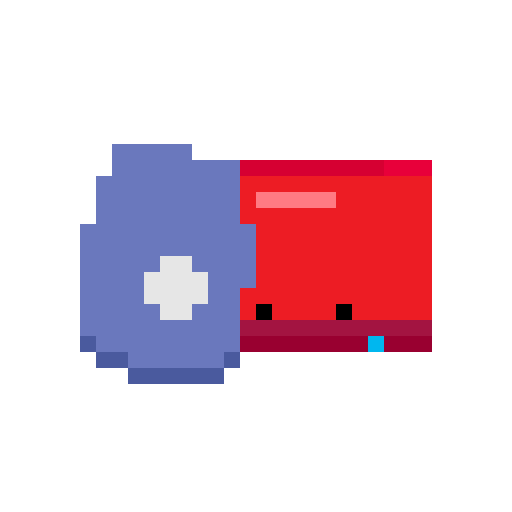
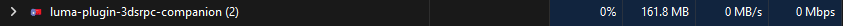

# luma-plugin-3dsrpc

A privacy-focused alternative for Discord Rich Presence on the 3DS.

Contact is @sirwaffly on discord for any help.

This project is licensed under the PolyForm Noncommercial License 1.0.0.

## Why this plugin was created

Right now there are 2 popular ways of getting Discord RPC functionality on 3DS. One of them is friend request based, and the other one requires a custom Luma3DS fork, which makes playing CTGP-7 impossible (without bypassing the anticheat). My solution aims to be privacy-focused as everything is run locally and does not require a fork of Luma3DS since it's a plugin that works with the vanilla version of Luma3DS.

## Limitations

Since this is a Luma3DS plugin it will not be able to run in games that already have one active plugin. CTGP-7 is an example of this, you're able to open the mod but it won't display it on Discord.

## How to install the plugin on the 3DS

Plugin loader should be enabled for this to work, to enable it do it through the Rosalina menu. To access the Rosalina menu press "L" + "D-Pad down" + "Select" at the same time. There are two separate ways of installing this plugin. 1 would be installing it separately for every game you own and 2 would be setting luma-plugin-3dsrpc as the default plugin for Luma3DS across all games.

Option 1: Inside of the root of your 3DS' SD card there should be a luma plugins folder at /luma/plugins. Create a folder with the Title ID of the game you wish to install the plugin for. It should look something like this /luma/plugins/000400000008C400 (I'm using the Title ID of Tomodachi Life's EU version as an example). Then we drop "luma-plugin-3dsrpc-release.3gx" inside of the game's ID folder.

Option 2: Inside of the same plugin folder used in the previous method there should be a "default.3gx". In most installations this plugin is HokakuCTR, this is a plugin made by the Pretendo team meant to log multiplayer traffic. If you intend to restore this plugin as the default at a later date I recommend renaming it to something like "default.3gx.bak". After that you put "luma-plugin-3dsrpc-release.3gx" inside of that same folder and rename it to "default.3gx".

IMPORTANT: BOTH METHODS NEED A "luma-plugin-3dsrpc.conf" FILE INSIDE OF /luma/plugins OR ELSE IT WILL NOT WORK. The structure of the config file needs to be the following.

```
ip=INSERT YOUR PC's IP HERE
port=47800
```

## How to install the companion app on PC

The companion app has only been tested on windows.

You have two ways of using the companion PC app. Either download the .jar file (smaller in size but requires a java 25 installation or newer) or you can download the .zip file that doesn't require a java installation (I recommend the zip file for most cases). If you need to change the port in any way you'll need the to edit the config.json file that is created once you've opened it for the first time. Simply edit the field that says "port" with the number matching your 3DS config file and restart the application (They are the same by default).

IF YOU OPEN THE .EXE IT WILL BE DISPLAYED AS A SYSTEM TRAY ICON, IF YOU WANT THE TERMINAL WINDOW YOU'LL HAVE TO USE THE .JAR.

To run it automatically every time you turn on your PC you can create a shortcut to the .exe and put it on the startup folder. You can get there by pressing "windows key" + "r" and typing "shell:startup". It consumes roughly 160mb of memory while running in the background.



## CTGP-7

As mentioned before, both methods of installation let you play in CTGP-7. But as CTGP-7 uses its own Luma3DS plugin, discord RPC will not show when playing CTGP-7, it will only show when playing vanilla MK7.

## Build the Luma3DS plugin yourself

First of all download devkitPro Updater from the [official github](https://github.com/devkitPro/installer/releases) and select the option that says "3DS Development". This gives you the compiler, libctru and an msys2 terminal.

Secondly, (using the msys2 terminal) follow the [CTRPluginFramework README](https://gitlab.com/thepixellizeross/ctrpluginframework) to add their package database. Then install CTRPluginFramework and [3gxtool](https://gitlab.com/thepixellizeross/3gxtool) with:

```
pacman -Sy
pacman -S libctrpf 3gxtool
```

Now you just have to go to the luma-plugin-3dsrpc project folder and type:

```
make luma-plugin-3dsrpc-release.3gx
```

## Build the companion app yourself

Install IntelliJ (as it comes with maven) and open the "companion" folder inside of the project (You need JDK25). Now from the Maven tab run "package" and it will create a .jar ready to run. If you want a ready to run file that doesn't need a java installation you can use jpackage to get an .exe.